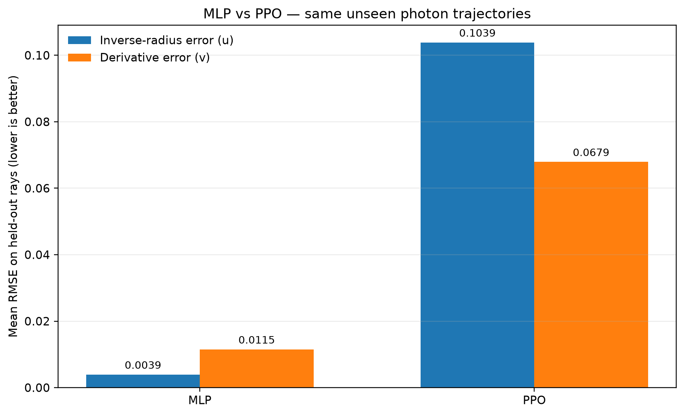
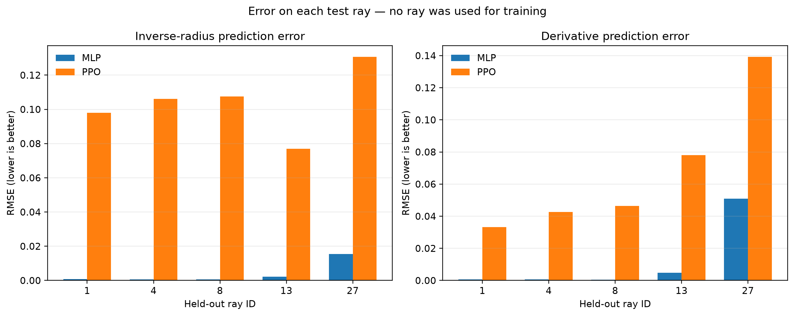
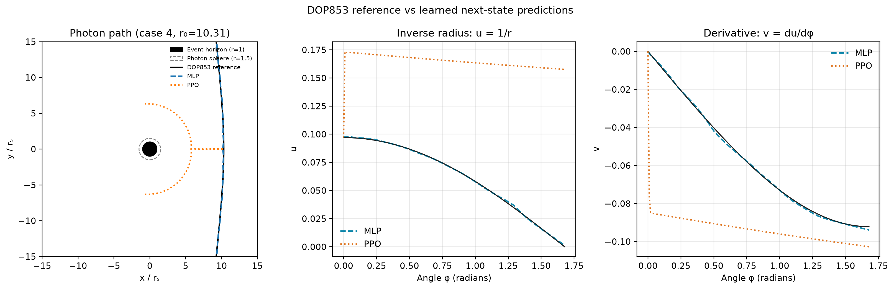

# Black Hole Lab — plain-language model comparison

## What was compared?

Two models were asked to predict the next point of the same photon trajectories:

- **MLP:** a supervised neural network trained from DOP853 examples. The selected architecture is `dynamics_architecture_sweep_relu_w128_d3` (three hidden layers, 128 neurons per layer, ReLU activation).
- **PPO:** a reinforcement-learning agent trained in the project's teacher-guided environment. It receives a reward when its next predicted state is close to the DOP853 reference.
- **DOP853:** the numerical reference used to create the trajectories. It is the target for this experiment, not an exact closed-form solution.

Both learned models were tested on the same 5 complete rays. Those ray IDs were held out from training. Evaluation was **autoregressive**: after the first point, each model receives its own previous prediction as the next input. This is important because small mistakes can build up over a long path.

## Results

- For u (inverse radius), **MLP** has the lower average error (0.00393737 for MLP vs 0.103868 for PPO).
- For v (change of inverse radius with angle), **MLP** has the lower average error (0.0115148 for MLP vs 0.0679325 for PPO).
- PPO's average u error is 2538.0% higher than MLP's.
- PPO's average v error is 490.0% higher than MLP's.

## What does the error mean?

- `u = 1/r` is inverse distance from the black hole. Lower u means farther away.
- `v = du/dφ` describes how u changes as the angle changes.
- **RMSE** is an average error measure. It is zero for a perfect match, and smaller is better.
- The plots show whether the predicted curve follows the reference curve. A low average error does not guarantee that every part of every path looks correct.

## A simple interpretation for the class

The MLP learns from examples: it sees many current states and the next correct state, then adjusts its weights to reduce prediction error.

PPO learns by trying actions: it proposes a next state, receives a reward based on how close that state is to the reference, and gradually adjusts its policy. PPO training takes longer, so we train it before the class and load the saved result during the live demonstration.

The model with the smaller RMSE is more accurate **on this test set and for this prediction task**. This experiment does not prove that one learning method is always better, and it does not mean that either model discovered Einstein's equations.

## Example ray

The trajectory plot uses test case `4`. The solid black line is the DOP853 reference; dashed and dotted lines are the MLP and PPO predictions.

## Important limitations

- The current dataset contains only 5 held-out test rays. Treat the result as a small experiment, not broad proof of generalization.
- Both learning methods use the same small trajectory dataset and the same state/action scaling.
- The PPO reward is teacher-guided: DOP853's next state is used inside the environment to calculate reward. The future target is not placed in the policy observation.
- This current PPO task predicts the next `(u, v)` state. It does **not** choose the numerical solver's step size.
- DOP853 is a high-accuracy numerical reference, not an analytical exact solution.

## Reproducibility

See `run_metadata.json` for checkpoint paths, test IDs, and training configuration references. Keep the dataset and split manifest unchanged when reproducing this comparison.
